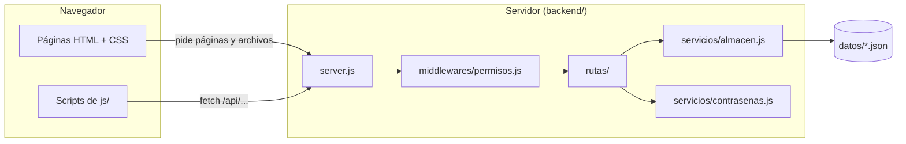
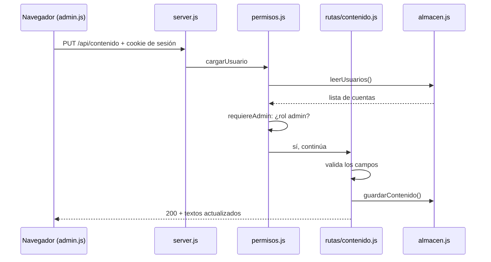
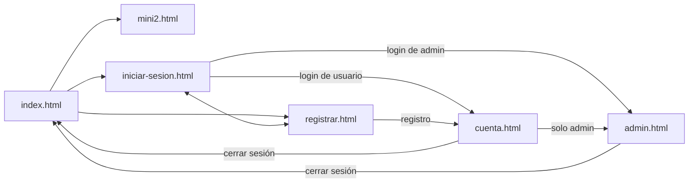

# Droner

Blog para quienes quieren iniciarse en el mundo de los drones.

El proyecto tiene dos partes:

- **Frontend**: las páginas del sitio (HTML, CSS y JavaScript que corre en el navegador).
- **Backend**: un servidor hecho con Node.js y Express que sirve esas páginas y simula un sistema de cuentas con dos roles, **usuario** y **administrador**.

Es un proyecto de práctica: los datos se guardan en archivos JSON en lugar de una base de datos real.

## Cómo ejecutarlo

Hace falta tener instalado [Node.js](https://nodejs.org) 18 o superior.

La primera vez, instalar las dependencias:

```bash
cd backend && npm install
```

Después, cada vez que se quiera levantar el sitio:

```bash
cd backend && npm start
```

Y entrar a <http://localhost:3000>.

Mientras se está programando conviene usar `npm run dev` en lugar de `npm start`: reinicia el servidor solo cada vez que se guarda un archivo del backend.

### Cuentas de prueba

En el primer arranque el servidor crea dos cuentas, una de cada rol. El correo y la contraseña de ambas están en [`backend/datos/semilla.json`](backend/datos/semilla.json).

Para volver al estado inicial (borrar las cuentas registradas y los textos editados) alcanza con detener el servidor, eliminar `backend/datos/usuarios.json` y `backend/datos/contenido.json`, y volver a arrancarlo.

### Sin el backend

Las páginas públicas se pueden seguir abriendo directamente (doble clic en `index.html`), pero en ese modo no hay cuentas: el menú muestra siempre «Ingresar» y los formularios avisan que no pudieron conectarse con el servidor.

## Qué puede hacer cada rol

| Acción | Visitante | Usuario | Administrador |
|---|:-:|:-:|:-:|
| Ver el inicio y el blog | ✔ | ✔ | ✔ |
| Registrarse e iniciar sesión | ✔ | — | — |
| Ver «Mi cuenta» | | ✔ | ✔ |
| Entrar al panel de administración | | | ✔ |
| Editar los textos de la portada y del artículo | | | ✔ |
| Ver la lista de usuarios | | | ✔ |
| Cambiar el rol de otra cuenta | | | ✔ |
| Eliminar otra cuenta | | | ✔ |

Reglas que aplica el servidor:

- Toda cuenta que se registra desde el formulario nace con rol **usuario**. La única forma de ser administrador es que otro administrador cambie el rol desde el panel.
- Un administrador **no puede cambiar su propio rol ni eliminar su propia cuenta**. Como quien hace el cambio sigue siendo administrador, el sitio nunca se queda sin ninguno.
- Los cambios de rol y las eliminaciones se aplican al instante, aunque la otra persona tenga la sesión abierta.

## Arquitectura

### Vista general



El navegador le habla al servidor de dos maneras: pidiendo **páginas y archivos** (lo que hace cualquier sitio) y haciendo **pedidos a la API** desde JavaScript, que devuelven datos en formato JSON. Todo pedido pasa primero por los permisos, después por la ruta que corresponde, y solo el almacén toca los archivos de datos.

### Estructura de carpetas

```
Droner/
├── index.html              Página de inicio: portada + galería + modal
├── mini2.html              Entrada del blog: DJI Mini 2 (carrusel + texto)
├── iniciar-sesion.html     Formulario de inicio de sesión
├── registrar.html          Formulario de registro
├── cuenta.html             «Mi cuenta» (requiere sesión)
├── admin.html              Panel de administración (requiere rol admin)
│
├── css/
│   └── styles.css          Todos los estilos propios del sitio
│
├── js/                     Scripts que corren en el NAVEGADOR
│   ├── api.js              Función pedirApi: única vía para hablar con el backend
│   ├── sesion.js           Adapta el menú según haya sesión; cerrar sesión
│   ├── contenido.js        Muestra los textos editables guardados
│   ├── formularios.js      Envía los formularios de login y registro
│   ├── cuenta.js           Completa la página «Mi cuenta»
│   └── admin.js            Maneja el panel de administración
│
├── assets/
│   └── img/                Imágenes del sitio (fotos de drones e íconos)
│
├── vendor/
│   └── bootstrap/          Bootstrap 5.1.3 (código de terceros, NO se edita)
│
├── backend/                Código que corre en el SERVIDOR
│   ├── server.js           Punto de entrada: configura y arranca el servidor
│   ├── package.json        Dependencias y comandos (npm start, npm run dev)
│   ├── rutas/
│   │   ├── auth.js         Registro, login, logout y consulta de sesión
│   │   ├── contenido.js    Leer y modificar los textos del sitio
│   │   └── usuarios.js     Listar, cambiar rol y eliminar cuentas
│   ├── middlewares/
│   │   └── permisos.js     Quién puede hacer qué
│   ├── servicios/
│   │   ├── almacen.js      Lectura y escritura de los archivos de datos
│   │   └── contrasenas.js  Hash y verificación de contraseñas
│   └── datos/
│       ├── semilla.json    Datos iniciales (se sube al repositorio)
│       ├── usuarios.json   Cuentas (lo genera el servidor; no se sube)
│       └── contenido.json  Textos editados (lo genera el servidor; no se sube)
│
├── .gitignore              Archivos que Git no debe subir
└── README.md               Este documento
```

Regla general: **las páginas van en la raíz**, lo que corre en el navegador en `css/` y `js/`, lo que corre en el servidor en `backend/`, y el código de terceros en `vendor/` y `backend/node_modules/`.

### Backend por capas

Cada carpeta del backend tiene una sola responsabilidad, y cada capa solo usa a la que tiene debajo:

| Capa | Archivos | Responsabilidad |
|---|---|---|
| Entrada | `server.js` | Configurar Express, las sesiones y el orden en que se atiende cada pedido |
| Permisos | `middlewares/permisos.js` | Averiguar quién hace el pedido y frenarlo si no tiene permiso |
| Rutas | `rutas/*.js` | Validar los datos recibidos, aplicar las reglas y armar la respuesta |
| Servicios | `servicios/*.js` | Tareas de bajo nivel: guardar en disco y calcular hashes |
| Datos | `datos/*.json` | Lo que queda guardado |

Recorrido de un pedido, por ejemplo cuando el administrador guarda un texto:



Si el pedido lo hiciera alguien sin sesión, `permisos.js` respondería **401** y la ruta nunca se ejecutaría; con sesión pero sin ser administrador, **403**.

### API

Todas las rutas empiezan con `/api`, reciben y devuelven JSON.

| Método | Ruta | Quién | Qué hace |
|---|---|---|---|
| `POST` | `/api/registro` | Cualquiera | Crea una cuenta con rol usuario y deja la sesión iniciada |
| `POST` | `/api/login` | Cualquiera | Inicia sesión |
| `POST` | `/api/logout` | Cualquiera | Cierra la sesión |
| `GET` | `/api/sesion` | Cualquiera | Devuelve el usuario con sesión iniciada, o `null` |
| `GET` | `/api/contenido` | Cualquiera | Devuelve los textos editables |
| `PUT` | `/api/contenido` | Admin | Modifica los textos editables |
| `GET` | `/api/usuarios` | Admin | Lista todas las cuentas |
| `PATCH` | `/api/usuarios/:id` | Admin | Cambia el rol de una cuenta |
| `DELETE` | `/api/usuarios/:id` | Admin | Elimina una cuenta |

Códigos de respuesta que usa: `200` salió bien, `201` se creó, `204` salió bien sin datos para devolver, `400` datos incorrectos, `401` hace falta iniciar sesión, `403` sin permiso, `404` no existe, `409` el correo ya está registrado, `500` error del servidor.

### Cómo funcionan las sesiones

1. El usuario envía correo y contraseña a `/api/login`.
2. Si son correctos, el servidor guarda en su memoria «la sesión X es del usuario Y» y le manda al navegador una **cookie** con el identificador X.
3. El navegador reenvía esa cookie automáticamente en cada pedido.
4. `permisos.js` lee la cookie, busca al usuario y lo deja disponible para la ruta.

Las sesiones viven en la memoria del servidor: **al reiniciarlo, todas se cierran**. Las cuentas y los textos no se pierden porque están en disco.

### Decisiones de seguridad

Aunque sea una simulación, el backend está hecho como se hace uno real:

- **Las contraseñas no se guardan.** Se guarda su hash (algoritmo *scrypt* con sal aleatoria por cuenta), y el hash nunca se envía al navegador.
- **Los permisos se controlan en el servidor.** Los scripts del navegador ocultan opciones por comodidad, pero quien bloquea de verdad es `permisos.js`. Llamar a la API a mano sin ser administrador devuelve 401 o 403.
- **El rol nunca se lee del formulario de registro**, así nadie puede crearse una cuenta de administrador.
- **El servidor solo publica las carpetas del sitio** (`css`, `js`, `assets`, `vendor`) y las páginas de una lista. No se puede pedir desde el navegador nada de `backend/`.
- **La cookie de sesión es `httpOnly` y `sameSite`**: el JavaScript de la página no puede leerla y otros sitios no pueden usarla.
- **Todo texto que escribe una persona se inserta con `textContent`**, nunca como HTML. Un nombre o un título con etiquetas se muestra como letras y no se ejecuta.
- **El servidor valida todo otra vez**, aunque el formulario ya lo haya hecho.
- **El mensaje de login incorrecto no aclara** si falló el correo o la contraseña.
- **El servidor escucha solo en esta computadora** (`127.0.0.1`).

### Frontend

Las seis páginas comparten el mismo esqueleto; solo cambia lo que va dentro de `<main>`:

```
<body>
├── <header class="header">        Encabezado: logo + menú (idéntico en todas)
├── <main>                         Contenido propio de cada página
└── <footer class="footer">        Pie de página (idéntico en todas)
```

Como el sitio no usa plantillas, **el encabezado y el pie están copiados en cada archivo**. Si se agrega una opción al menú hay que hacerlo en los seis HTML.

| Página | Acceso | `<main>` | Scripts propios | Bootstrap JS |
|---|---|---|---|---|
| `index.html` | Público | `.content` → `.portada` + `.galeria` | `api`, `sesion`, `contenido` | Modal |
| `mini2.html` | Público | `.content` → `.articulo` | `api`, `sesion`, `contenido` | Carrusel |
| `iniciar-sesion.html` | Público | `.login` → `.login__container` | `api`, `sesion`, `formularios` | — |
| `registrar.html` | Público | `.login` → `.login__container` | `api`, `sesion`, `formularios` | — |
| `cuenta.html` | Con sesión | `.content` → `.panel` | `api`, `sesion`, `cuenta` | — |
| `admin.html` | Solo admin | `.content` → `.panel` | `api`, `sesion`, `admin` | — |

`api.js` va siempre primero porque los demás scripts usan su función `pedirApi`.

**Cómo se conecta el HTML con los scripts.** Los scripts no buscan los elementos por su clase de CSS sino por atributos `data-…` puestos para eso (`data-menu-sesion`, `data-contenido`, `data-formulario`, `data-cuenta`, `data-admin`). Así se puede cambiar el diseño sin romper el comportamiento, y al leer el HTML se ve qué elementos maneja un script.

**Textos editables.** Los títulos y párrafos que el administrador puede cambiar tienen el texto original escrito en el HTML y un atributo `data-contenido`. Al cargar la página, `contenido.js` los reemplaza por lo que haya guardado. Si el backend no responde, queda el texto del HTML.

### Mapa de navegación



Si alguien sin sesión intenta abrir `cuenta.html` o `admin.html`, el servidor lo redirige al login. Si un usuario común intenta abrir `admin.html`, lo redirige a su cuenta.

### Organización de `css/styles.css`

El archivo está dividido en secciones numeradas, en el mismo orden en que aparecen las cosas en pantalla:

1. **Variables globales** — colores y medidas del sitio. Cambiar un valor acá lo cambia en todo el sitio.
2. **Reset y base**
3. **Encabezado y logo**
4. **Menú y submenús**
5. **Contenido principal** — el fondo degradado.
6. **Portada**
7. **Galería de miniaturas**
8. **Artículo del blog**
9. **Login y registro**
10. **Pie de página**
11. **Panel** — páginas «Mi cuenta» y «Panel de administración».
12. **Responsive** — ajustes para pantallas de 600px o menos.

**Convención de nombres: BEM** (`bloque__elemento--modificador`). Los nombres propios están en español a propósito para **no chocar con las clases de Bootstrap** (`.container`, `.carousel`, `.modal`…). Si una clase está en inglés y no aparece en `styles.css`, es de Bootstrap.

En todas las páginas `styles.css` se carga *después* de Bootstrap: cuando dos reglas tienen el mismo peso gana la última, así que el estilo propio siempre puede pisar al de Bootstrap.

### Comentarios en el código

Todo el código propio está comentado línea por línea, en español:

- En los **HTML**, el comentario va en la línea de arriba de cada etiqueta y explica para qué sirve la etiqueta y cada uno de sus atributos.
- En el **CSS**, cada regla tiene un comentario arriba que dice a qué elemento apunta y cada propiedad tiene al lado qué efecto produce.
- En el **JS** (del navegador y del servidor), cada archivo empieza con un bloque que explica su papel, y cada instrucción tiene arriba qué hace y por qué.

Los archivos de `vendor/` y `backend/node_modules/` no están comentados porque son de terceros.

## Correcciones realizadas sobre el sitio original

### Errores que rompían algo

| Problema | Solución |
|---|---|
| Selector `..carousel` (dos puntos) en el CSS: la regla entera era inválida | Se renombró el bloque a `.galeria` con el selector bien escrito |
| La clase propia `.carousel` chocaba con el carrusel de Bootstrap de `mini2.html` | Mismo cambio: `.galeria`, `.galeria__container`, `.galeria__item` |
| El HTML no tenía el contenedor `.carousel__container`, así que los efectos al pasar el mouse nunca se aplicaban | Se agregó `.galeria__container` |
| La clase propia `.container` pisaba a la de Bootstrap | Se renombró a `.header__container` |
| El submenú no estaba posicionado: al abrirse empujaba y deformaba el encabezado | Ahora usa `position: absolute` respecto de su ítem |
| El encabezado usaba `float` con propiedades de flexbox que no tenían efecto | Se rehízo con flexbox |
| `display: grid inline-table` y `position: center` no son valores válidos | Se eliminaron |
| El botón «Eentiendo» del modal no cerraba la ventana | Ahora cierra, y se corrigió el texto |
| Los formularios recargaban la página al enviarse | `js/formularios.js` los envía al backend y muestra el resultado |
| `.gitignore` con renglones pegados (`.DS_storepackage`, `*.txt*.gif`): no ignoraba nada | Se reescribió con una regla por renglón |
| `index.html` tenía dos etiquetas `<title>` (una decía «Dronert») | Queda una sola por página |

### Enlaces

- «Blog» solo funcionaba desde el inicio; ahora funciona en las cuatro páginas.
- Los enlaces del pie apuntaban a `/` (la raíz del servidor, fuera del sitio); ahora apuntan a `#` hasta que existan esas páginas.
- El enlace «inicio» del pie de login y registro llevaba al login; ahora lleva a `index.html`.
- «Marcas › DJI» lleva al artículo del Mini 2. Parrot y Syma se muestran como «próximamente» en lugar de ser enlaces que no van a ningún lado.

### Estructura y limpieza

- Bootstrap estaba subido dos veces (el `.zip` y la carpeta descomprimida, con una carpeta anidada de más). Quedan solo los dos archivos que se usan, en `vendor/bootstrap/`. La carpeta del proyecto pasó de 13 MB a menos de 2 MB.
- El JavaScript de Bootstrap se cargaba desde internet y el CSS desde la carpeta local; ahora los dos son locales y el sitio funciona sin conexión.
- `addsets/` (error de tipeo) pasó a `assets/img/`, y las imágenes tienen nombres descriptivos (`1.png` → `mavic-air-2.png`, etc.).
- `styles.css` pasó a `css/styles.css`.
- Se eliminaron las reglas CSS que no usaba ninguna página (`.main`, `.parrafoPrincipal`, `.imagenPrincipal`) y las propiedades duplicadas.
- Login y registro cargaban scripts de Bootstrap que no usaban y no cargaban su CSS, por lo que el encabezado se veía distinto al del resto del sitio. Ahora las cuatro páginas comparten la misma base.
- Se quitó la tipografía Muli de Google Fonts: solo se aplicaba a los campos del formulario.

### Accesibilidad y semántica

- `lang="es"` en lugar de `lang="en"`.
- Un solo `<h1>` por página (antes el logo también era un `<h1>`).
- Etiquetas `<main>`, `<section>`, `<article>` y `<nav>` donde corresponde.
- Las miniaturas y los títulos de submenú son `<button>`: se pueden usar con el teclado.
- Los campos de formulario tienen `<label>`, `name`, `type` correcto (`email`), `autocomplete` y `required`.
- Textos alternativos reales en las imágenes (antes `alt=""` o `alt="..."`).
- Encabezado adaptado a celulares.

### Contenido

- La portada tenía «titulo principal» y un *lorem ipsum*; se reemplazó por un texto de presentación.
- El artículo se titulaba «Mini 2» pero describía el Mavic Mini (incluido el alcance de 4 km). Se corrigió con los datos del DJI Mini 2.
- Errores de tipeo: «Eentiendo», «IRegistrate», «iniciate en a=el mundo».

## Pendientes

- **Base de datos real.** Los archivos JSON sirven para practicar, pero no para un sitio con muchos usuarios a la vez.
- **Publicarlo.** Para ponerlo en internet hace falta HTTPS, la cookie con `secure: true`, un secreto de sesión fijo y un almacén de sesiones que no sea la memoria.
- **Límite de intentos de login.** Hoy se puede probar contraseñas sin límite.
- **Recuperación de contraseña** y edición de los datos de la propia cuenta.
- **Accesos con Google y Twitter:** siguen siendo solo visuales.
- **Páginas que faltan:** Términos de uso, Declaración de privacidad, Centro de ayuda y las marcas Parrot y Syma.
- **Más entradas de blog.** Las tres miniaturas del inicio abren el aviso de «no disponible», y el panel solo edita la entrada que existe.
- **Carrusel del Mini 2:** la tercera foto es de un Mavic Air 2. Conviene reemplazarla por otra del Mini 2.
- **Contraste de colores:** el texto gris del menú y los textos blancos sobre el celeste y el verde tienen poco contraste.
- **Encabezado y pie duplicados** en los seis HTML. Si el sitio crece, conviene generarlos desde el servidor con plantillas.
