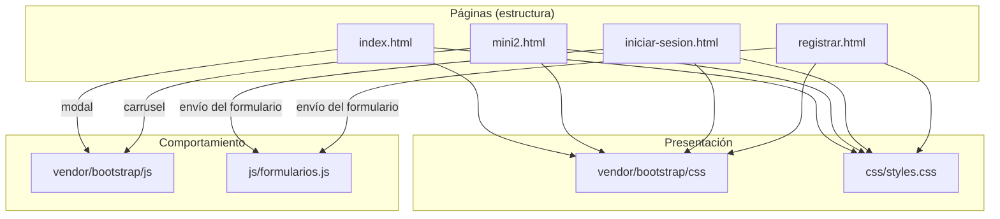
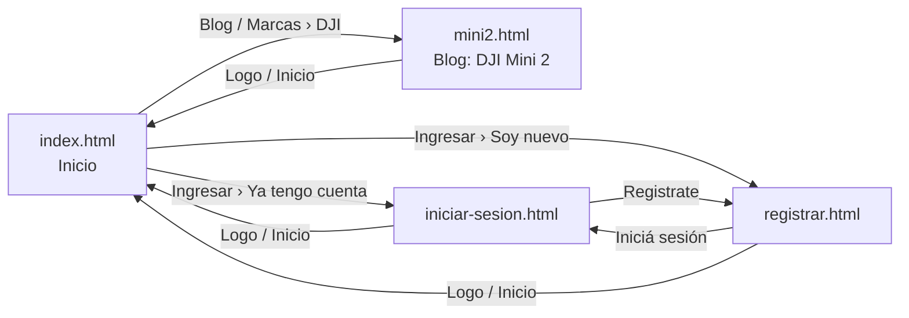

# Droner

Blog para quienes quieren iniciarse en el mundo de los drones.

Es un **sitio web estático**: solo HTML, CSS y un poco de JavaScript. No tiene servidor, base de datos ni paso de compilación; lo que está en la carpeta es exactamente lo que ve el navegador.

## Cómo verlo

Opción rápida: abrir `index.html` con doble clic.

Opción recomendada (se comporta igual que cuando esté publicado): levantar un servidor local desde la carpeta del proyecto.

```bash
python3 -m http.server 8000
```

Después entrar a <http://localhost:8000>.

## Arquitectura

### Estructura de carpetas

```
Droner/
├── index.html              Página de inicio: portada + galería + modal
├── mini2.html              Entrada del blog: DJI Mini 2 (carrusel + texto)
├── iniciar-sesion.html     Formulario de inicio de sesión
├── registrar.html          Formulario de registro
│
├── css/
│   └── styles.css          Todos los estilos propios del sitio
│
├── js/
│   └── formularios.js      Comportamiento de los formularios de login y registro
│
├── assets/
│   └── img/                Imágenes del sitio (fotos de drones e íconos)
│
├── vendor/
│   └── bootstrap/          Bootstrap 5.1.3 (código de terceros, NO se edita)
│       ├── css/bootstrap.min.css
│       └── js/bootstrap.bundle.min.js
│
├── .gitignore              Archivos que Git no debe subir
└── README.md               Este documento
```

Regla general: **las páginas van en la raíz** y todo lo demás en una carpeta según su tipo. El código propio (`css/`, `js/`) está separado del código de terceros (`vendor/`), así queda claro qué se puede modificar y qué no.

### Capas

Cada página se arma con tres capas que tienen una responsabilidad cada una:

| Capa | Archivos | Responsabilidad |
|---|---|---|
| Estructura | `*.html` | Qué contenido hay y qué significa (encabezado, navegación, artículo, formulario) |
| Presentación | `vendor/bootstrap/css` + `css/styles.css` | Cómo se ve: colores, tamaños, disposición, adaptación a celular |
| Comportamiento | `vendor/bootstrap/js` + `js/formularios.js` | Qué pasa cuando el usuario interactúa (abrir el modal, pasar fotos, enviar un formulario) |



Dos decisiones a tener en cuenta:

- **Orden de los estilos.** En todas las páginas `styles.css` se carga *después* de Bootstrap. Cuando dos reglas tienen el mismo peso gana la última, así que el estilo propio siempre puede pisar al de Bootstrap.
- **Cada página carga solo el JavaScript que usa.** El de Bootstrap se necesita para el modal (inicio) y el carrusel (Mini 2); las páginas de login y registro no lo cargan y usan únicamente `formularios.js`.

### Esqueleto común de las páginas

Las cuatro páginas comparten el mismo esqueleto. Solo cambia lo que va dentro de `<main>`:

```
<body>
├── <header class="header">        Encabezado: logo + menú (idéntico en las 4 páginas)
├── <main>                         Contenido propio de cada página
└── <footer class="footer">        Pie de página (idéntico en las 4 páginas)
```

Como el sitio no usa plantillas, **el encabezado y el pie están copiados en cada archivo**. Si se agrega una opción al menú hay que hacerlo en los cuatro HTML. La única diferencia entre copias es el atributo `aria-current="page"`, que marca cuál es la página actual para que el CSS la resalte.

### Mapa de navegación



El menú es el mismo en todas las páginas, así que desde cualquiera se llega a cualquier otra.

### Contenido de cada página

| Página | `<main>` | Componentes de Bootstrap | Script |
|---|---|---|---|
| `index.html` | `.content` → `.portada` + `.galeria` | Modal | `bootstrap.bundle.min.js` |
| `mini2.html` | `.content` → `.articulo` | Carrusel | `bootstrap.bundle.min.js` |
| `iniciar-sesion.html` | `.login` → `.login__container` | — | `formularios.js` |
| `registrar.html` | `.login` → `.login__container` | — | `formularios.js` |

### Organización de `css/styles.css`

El archivo está dividido en secciones numeradas, en el mismo orden en que aparecen las cosas en pantalla:

1. **Variables globales** — colores y medidas del sitio (`--color-primario`, `--alto-header`, etc.). Cambiar un valor acá lo cambia en todo el sitio.
2. **Reset y base** — quita márgenes por defecto y arma el `body` en columna para que el pie quede siempre abajo.
3. **Encabezado y logo**
4. **Menú y submenús**
5. **Contenido principal** — el fondo degradado.
6. **Portada**
7. **Galería de miniaturas**
8. **Artículo del blog**
9. **Login y registro**
10. **Pie de página**
11. **Responsive** — ajustes para pantallas de 600px o menos.

**Convención de nombres: BEM** (`bloque__elemento--modificador`). Por ejemplo `.galeria` es el bloque, `.galeria__item` un elemento que vive dentro, y `.login__container--form` una variante de `.login__container`.

Los nombres propios están en español a propósito para **no chocar con las clases de Bootstrap** (`.container`, `.carousel`, `.modal`…). Si una clase está en inglés y no aparece en `styles.css`, es de Bootstrap.

### Comentarios en el código

Todo el código propio está comentado línea por línea, en español:

- En los **HTML**, el comentario va en la línea de arriba de cada etiqueta y explica para qué sirve la etiqueta y cada uno de sus atributos.
- En el **CSS**, cada regla tiene un comentario arriba que dice a qué elemento apunta y cada propiedad tiene al lado qué efecto produce.
- En el **JS**, cada instrucción tiene arriba una explicación de qué hace y por qué.

Los archivos de `vendor/` no están comentados porque son de terceros y están minificados.

## Correcciones realizadas

### Errores que rompían algo

| Problema | Solución |
|---|---|
| Selector `..carousel` (dos puntos) en el CSS: la regla entera era inválida | Se renombró el bloque a `.galeria` con el selector bien escrito |
| La clase propia `.carousel` chocaba con el carrusel de Bootstrap de `mini2.html` | Mismo cambio: `.galeria`, `.galeria__container`, `.galeria__item` |
| El HTML no tenía el contenedor `.carousel__container`, así que los efectos al pasar el mouse nunca se aplicaban | Se agregó `.galeria__container` |
| La clase propia `.container` pisaba a la de Bootstrap | Se renombró a `.header__container` |
| El submenú no estaba posicionado: al abrirse empujaba y deformaba el encabezado | Ahora usa `position: absolute` respecto de su ítem |
| El encabezado usaba `float` con propiedades de flexbox que no tenían efecto | Se rehízo con flexbox |
| `display: grid inline-table` y `position: center` no son valores válidos | Se eliminaron |
| El botón «Eentiendo» del modal no cerraba la ventana | Ahora cierra, y se corrigió el texto |
| Los formularios recargaban la página al enviarse | `js/formularios.js` frena el envío y muestra un aviso |
| `.gitignore` con renglones pegados (`.DS_storepackage`, `*.txt*.gif`): no ignoraba nada | Se reescribió con una regla por renglón |
| `index.html` tenía dos etiquetas `<title>` (una decía «Dronert») | Queda una sola por página |

### Enlaces

- «Blog» solo funcionaba desde el inicio; ahora funciona en las cuatro páginas.
- Los enlaces del pie apuntaban a `/` (la raíz del servidor, fuera del sitio); ahora apuntan a `#` hasta que existan esas páginas.
- El enlace «inicio» del pie de login y registro llevaba al login; ahora lleva a `index.html`.
- «Marcas › DJI» lleva al artículo del Mini 2. Parrot y Syma se muestran como «próximamente» en lugar de ser enlaces que no van a ningún lado.

### Estructura y limpieza

- Bootstrap estaba subido dos veces (el `.zip` y la carpeta descomprimida, con una carpeta anidada de más). Quedan solo los dos archivos que se usan, en `vendor/bootstrap/`. La carpeta del proyecto pasó de 13 MB a menos de 2 MB.
- El JavaScript de Bootstrap se cargaba desde internet y el CSS desde la carpeta local; ahora los dos son locales y el sitio funciona sin conexión.
- `addsets/` (error de tipeo) pasó a `assets/img/`, y las imágenes tienen nombres descriptivos (`1.png` → `mavic-air-2.png`, etc.).
- `styles.css` pasó a `css/styles.css`.
- Se eliminaron las reglas CSS que no usaba ninguna página (`.main`, `.parrafoPrincipal`, `.imagenPrincipal`) y las propiedades duplicadas.
- Login y registro cargaban scripts de Bootstrap que no usaban y no cargaban su CSS, por lo que el encabezado se veía distinto al del resto del sitio. Ahora las cuatro páginas comparten la misma base.
- Se quitó la tipografía Muli de Google Fonts: solo se aplicaba a los campos del formulario.

### Accesibilidad y semántica

- `lang="es"` en lugar de `lang="en"`.
- Un solo `<h1>` por página (antes el logo también era un `<h1>`).
- Etiquetas `<main>`, `<section>`, `<article>` y `<nav>` donde corresponde.
- Las miniaturas y los títulos de submenú son `<button>`: se pueden usar con el teclado.
- Los campos de formulario tienen `<label>`, `name`, `type` correcto (`email`), `autocomplete` y `required`.
- Textos alternativos reales en las imágenes (antes `alt=""` o `alt="..."`).
- Encabezado adaptado a celulares.

### Contenido

- La portada tenía «titulo principal» y un *lorem ipsum*; se reemplazó por un texto de presentación.
- El artículo se titulaba «Mini 2» pero describía el Mavic Mini (incluido el alcance de 4 km). Se corrigió con los datos del DJI Mini 2.
- Errores de tipeo: «Eentiendo», «IRegistrate», «iniciate en a=el mundo».

## Pendientes

Cosas que no son errores de código sino funciones o contenido que todavía no existen:

- **Login y registro reales.** Hace falta un servidor (backend) que reciba los datos. Los accesos con Google y Twitter son solo visuales.
- **Páginas que faltan:** Términos de uso, Declaración de privacidad, Centro de ayuda, recuperación de contraseña y las marcas Parrot y Syma.
- **Más entradas de blog.** Las tres miniaturas del inicio abren el aviso de «no disponible».
- **Carrusel del Mini 2:** la tercera foto es de un Mavic Air 2. Conviene reemplazarla por otra del Mini 2.
- **Contraste de colores:** el texto gris del menú y los textos blancos sobre el celeste y el verde tienen poco contraste y cuestan leerse. Mejorarlo implica revisar la paleta.
- **Encabezado y pie duplicados** en los cuatro HTML. Si el sitio crece, conviene pasar a un generador de sitios estáticos o a plantillas.
